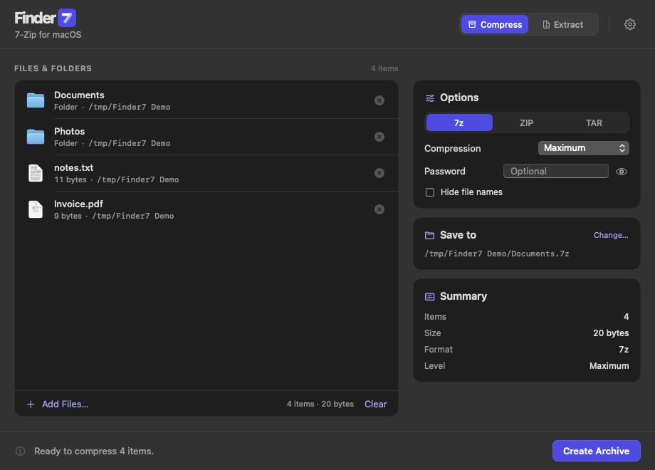

# Finder7

A small, native 7-Zip GUI for macOS, built with SwiftUI around the official
`7zz` engine.



Finder7 compresses and extracts archives without Electron, Homebrew or a
third-party runtime. It is a normal, unsandboxed macOS app: drag files onto the
window, use the Finder context menu, or let it handle archive file types.

## What it does

- **Compress** to 7z, ZIP or TAR, with Store → Ultra levels and optional
  AES-256 encryption (including encrypted file names for 7z).
- **Extract** 7z, ZIP, RAR, TAR, GZ, BZ2, XZ, CAB, ISO, DMG, WIM, MSI and the
  rest of 7-Zip's format list.
- **Finder context menu** — right-click a selection and choose **Services →
  Compress with Finder7** or **Extract with Finder7**. macOS launches Finder7
  if it isn't running. If the items are hidden, enable them in **System
  Settings → Keyboard → Keyboard Shortcuts → Services**.
- **Engine updates in the app** — check the official `ip7z/7zip` release,
  download and SHA-256 verify both macOS slices, smoke-test the new engine,
  swap it in, re-sign the app bundle, and offer a restart. Nothing is
  downloaded until you ask. No manual rebuild is needed.
- **File associations** — in **Settings → Finder → File associations**, choose
  the extensions that open in Finder7. Turning a type off restores the previous
  handler.
- Drag and drop, live progress, cancel, a raw `7zz` log, and a finished state
  with **Show in Finder**.
- Universal Apple Silicon + Intel app, ad-hoc signed and self-contained.

## Requirements

- macOS 14 or later
- Xcode command line tools (Swift, lipo, codesign)
- Python 3 (the system Python is enough)

## Build

The 7-Zip engine is **not committed** to this repository. Fetch the official
prebuilt universal binary first:

```bash
./Scripts/fetch-engine.sh          # latest official release
./Scripts/fetch-engine.sh 26.06    # or pin a release
```

The script downloads the arm64 and x86_64 tarballs, verifies their SHA-256
digests, checks the banner and licenses, and writes the ignored `Vendor/7zz`.
Then build, sign and smoke-test the app:

```bash
./Scripts/build-app.sh
open dist/Finder7.app
```

Move `Finder7.app` to `/Applications` before using Finder actions or changing
file associations, so LaunchServices registers it in a stable location.

## Checks

```bash
./Scripts/test.sh           # Swift unit tests + self-update integration
./Scripts/check-engine.sh   # engine provenance, licenses, CLI contract, bundle
```

## Notes

- The Finder actions live under **Services**, the supported macOS route for
  acting on any Finder selection without a sandboxed Finder Sync extension.
- File associations use the deprecated, unsandboxed-only LaunchServices API.
  This app is not sandboxed and is not prepared for the Mac App Store.
- Ad-hoc signed builds show a Gatekeeper warning on other Macs; Developer ID
  signing and notarization are left to the distributor.

## License

The GUI is GPLv3; see [`LICENSE`](LICENSE). The bundled 7-Zip engine is a
separate work by Igor Pavlov under the GNU LGPL (with the unRAR restriction for
RAR support). See [`Vendor/License.txt`](Vendor/License.txt) and
<https://www.7-zip.org/license.txt>.
